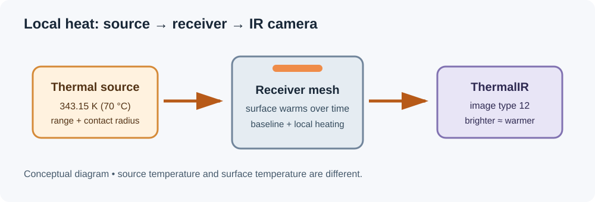

# Apply a heat source to an object

This guide shows how to warm part of a mesh in the Cosys AirSim project, inspect it with the thermal camera, and reuse the setup in a Blueprint. The numbers are example settings, not measured temperatures.

## Before you start

1. Open `Open_Thermal_CombinedEnvironment.cmd` in the project folder and wait for Unreal Editor. This opens the retained combined scene; close another AirSim editor first.
2. Choose an ordinary static mesh actor near the camera, such as a vehicle or counter. Select it in the viewport or **World Outliner**. Save a copy of the map if you want to keep the demonstration separate.
3. Open the **Content Browser** and navigate to `/Game/Thermal/Blueprints`.

A thermal *baseline* sets an object's unheated temperature. A *source* adds energy locally and the receiving surface changes temperature over time. Pick a baseline for an evenly cold object; use a source for a hot hood, tire, lamp housing, or counter.

## Add a point source

1. Drag **BP_ThermalPoint** from the Content Browser into the level. Select the new source in the World Outliner.
2. Move it close to the surface to be warmed. Keep a radiating source just outside the object's surface so that the object's collision does not block it. Use the transform gizmo to adjust placement.
3. In **Details**, search for each setting below. Names can be found in the Thermal category; expand the category if necessary.

   | Setting | Starting value | What it controls |
   |---|---:|---|
   | **Temperature Kelvin** | `343.15` | Source temperature, equivalent to 70 °C. |
   | **Parent Receiver** | Your selected mesh actor | The object receiving direct contact heat; use the eyedropper. |
   | **Heat Parent Surface** | Enabled | Applies contact heat to the receiver. |
   | **Parent Contact Radius Cm** | `100` | Starting size of the local contact region: 100 cm = 1 m. |
   | **Parent Conductance** | Start with its existing value | Controls the rate of direct heat transfer. |
   | **Range Cm** | `300` | Example radiation reach: 300 cm = 3 m. |
   | **Occlusion** | Enabled | Visibility collision can block radiated heat. |

4. Leave the source **Enabled**, save the map, and press **Play**. Allow time for the surface to warm, then inspect the thermal preview. The source temperature is not an instant assignment to the entire object; the observed temperature depends on the receiver, location, transfer and time.
5. To stop heating, turn **Enabled** off. Previously deposited heat remains and cools gradually. Stop Play before saving persistent changes.

**Units:** source and receiver temperatures use Kelvin: `K = °C + 273.15`. The scene settings actor uses Celsius for its category baselines. A visible light's color temperature is separate from physical heat-source temperature.

## Choose the shape

| Blueprint | Use and orientation |
|---|---|
| `BP_ThermalPoint` | Omnidirectional starting point for a compact source. |
| `BP_ThermalSpot` | Cone along local **+X**; adjust inner and outer angles. |
| `BP_ThermalRect` | Rectangular emitter facing local **+X**; adjust width and height. |
| `BP_ThermalDirectional` | Bounded directional beam along local **+X**. |
| `BP_ThermalCapsule` | Extended emitter along local **Z**. |

For a wheel, a child source with a **Finite Cylinder** parent contact region can target the tire band. Align local **+X** with the axle and set inner radius, outer radius and half-length to fit; material-index restrictions can exclude metal where slots permit.

## Add heat to a reusable Blueprint

1. Open your object's Blueprint. If editing a shared sample, duplicate it first.
2. Add a **Child Actor Component** under the mesh, then set its **Child Actor Class** to a thermal source Blueprint.
3. Move and rotate the child to the desired hot region. Expand **Child Actor Template** to edit instance properties. A child source can infer its parent receiver; a separately placed source needs the explicit **Parent Receiver** reference.
4. Add separate child sources for independently heated regions, such as a hood and tires. **Compile** and **Save** the Blueprint, then test an instance in Play.

`BP_ThermalHatchback` in `/Game/Thermal/Blueprints` illustrates a hood, two headlight sources and four tire sources. Editing shared class defaults affects every instance that uses that class; duplicate a source class if its defaults need to differ.

## Check the result

Use **ThermalIR, image type 12**, not stock Infrared type 7. Keep the same display temperature range when comparing images; the provided scene settings use 280–380 K. Hotter surfaces generally appear brighter, but emissivity, distance, display range and warm-up time also matter. If the result is cold, check that the source is enabled, the correct receiver is assigned, the contact region overlaps the mesh, and collision is not blocking radiation. Let the simulation run and verify with a fixed camera.

The following are actual paired captures from the earlier evening sample. That sample map is archived; the images show the relationship between RGB appearance and the thermal view, not a screenshot of the current combined map.

| RGB capture | ThermalIR capture |
|---|---|
|  |  |

Visible RGB lamps and thermal emitters are configured separately. Decorative water/reflection planes are excluded from local heating. Local mesh heating in a packaged build requires **Allow CPU Access** on receiver mesh assets. Landscape supports a whole-terrain baseline, not the mesh-surface local heating described here.

For background, baseline controls, occlusion and model limits, see the [thermal reference](../../Thermal_Scene_Guide.md). For the current map and capture setup, see the [combined scene guide](../SceneDiversity/COMBINED_ENVIRONMENT.md).
